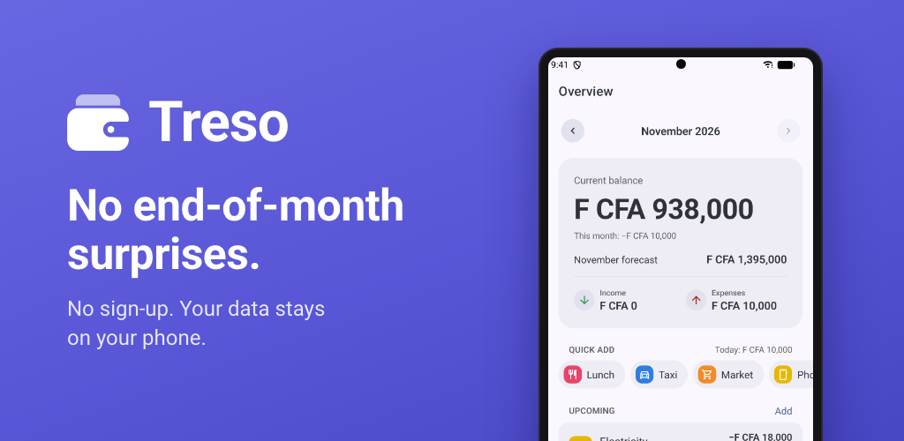
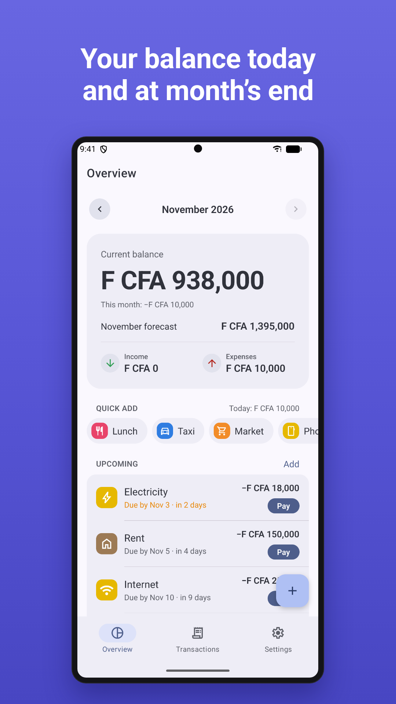
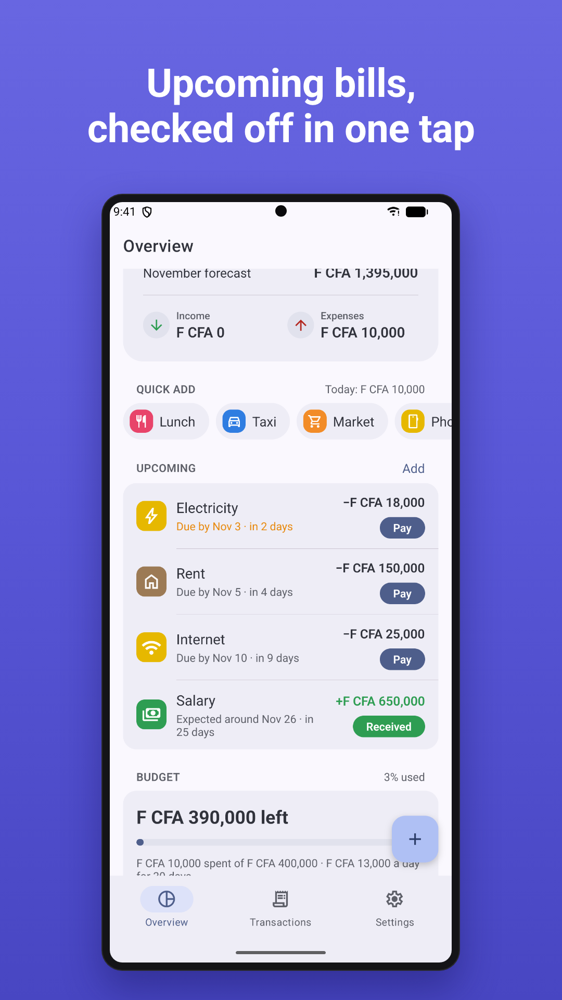
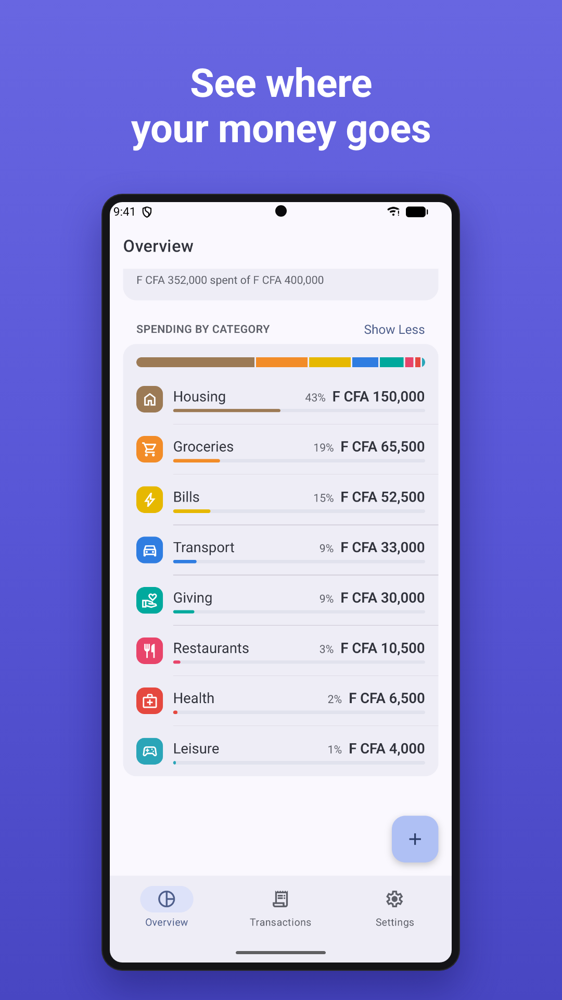
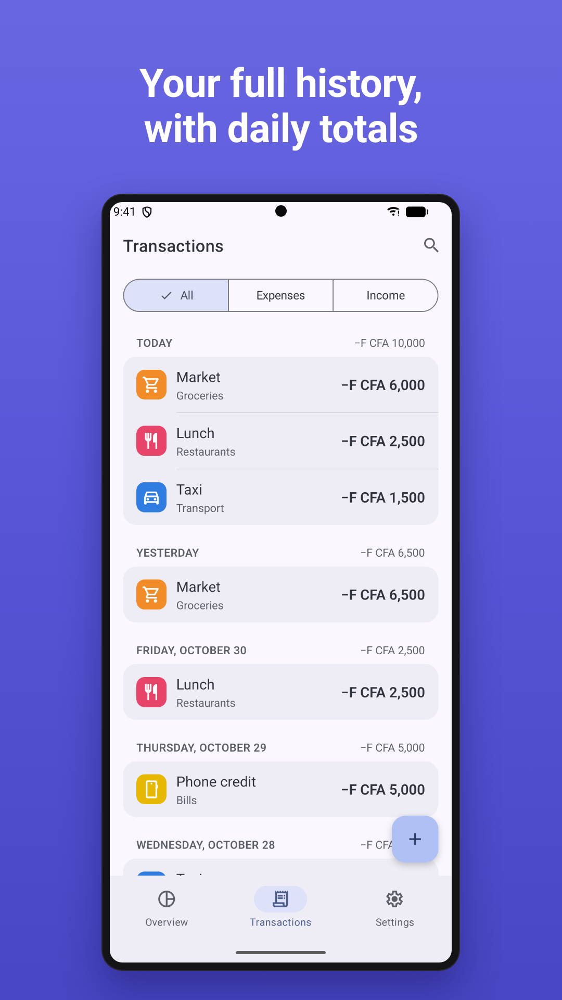
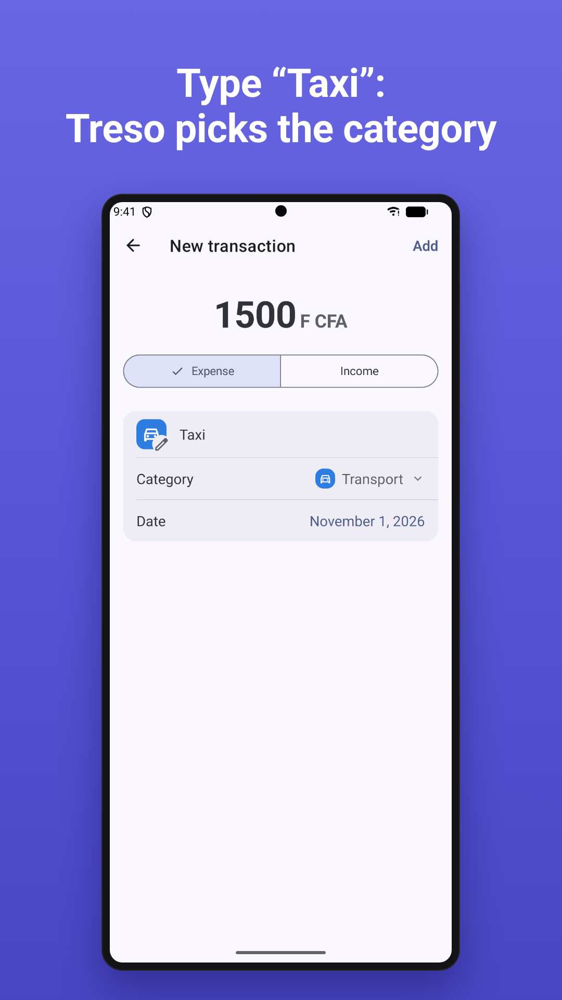
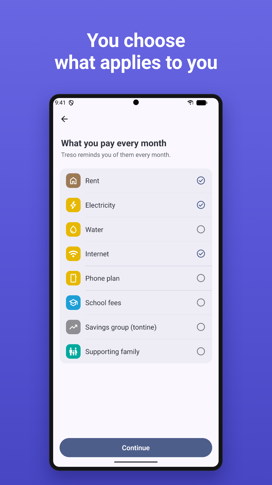

# Treso

<p align="center">
  
</p>

<p align="center">
  <a href="https://github.com/lucien-loua/treso/actions/workflows/ci.yml"></a>
  <a href="LICENSE"></a>
  <a href="https://expo.dev"></a>
</p>

Treso is a personal finance app for Android and iOS: track your income, your expenses and what you have left, today and at the end of the month. It is built for everyday life in West Africa (CFA franc, Guinean franc, US dollar) and speaks French and English, following the phone's language.

Private by design: no account, no server, no tracking. Your data stays on your phone.

<p align="center">
  
  
  
</p>
<p align="center">
  
  
  
</p>

## Features

- **Built around you.** A one-minute first launch asks where your money comes from, what you pay every month and what you spend on day to day; the app then only suggests what applies to you. Change it anytime in Settings.
- **Monthly overview.** Current balance, what this month added, the expected end-of-month balance, spending by category and an optional budget.
- **Recurring items.** Salary around the 26th, rent by the 5th, bills by the 3rd: Treso keeps track of them under "Upcoming", and you confirm with one tap when they're paid or received.
- **Quick add.** Everyday expenses (transport, meals…) in one tap; when you type a name, the category is guessed ("Taxi" is transport).
- **Several currencies.** Each amount keeps the currency it was entered in; switching currency converts at the day's rates (downloaded daily, or your own).
- **Your data, your files.** Export a full backup and import it on this phone or another, or export a spreadsheet (CSV) for Excel or Google Sheets.

## Privacy

Everything is stored on the device (SQLite). The only network request downloads public exchange rates once a day. Backups and exports leave the phone only when you share them. See [PRIVACY.md](PRIVACY.md).

## Getting started

You need [Bun](https://bun.sh).

```bash
git clone https://github.com/lucien-loua/treso.git
cd treso
bun install
```

**In a development build (recommended).** A [development build](https://docs.expo.dev/develop/development-builds/introduction/) is your own build of Treso with developer tools. It runs the app's real native setup: icon, splash screen, permissions, per-app language. Set up Android Studio and Java, or Xcode, with [Expo's guide](https://docs.expo.dev/get-started/set-up-your-environment/), then:

```bash
bun run android
bun run ios        # on a Mac
```

The command builds the app, installs it on an emulator, simulator or connected phone, and starts the dev server. Afterwards, `bun start` is enough. Build again only after adding a native library, changing `app.json` or upgrading the Expo SDK.

**In Expo Go.** Without Android Studio or Xcode, run `bunx expo start --go` and scan the QR code with [Expo Go](https://expo.dev/go). Every feature works there; only the native setup differs.

| Command             | What it does                      |
| ------------------- | --------------------------------- |
| `bun start`         | Start the dev server              |
| `bun run check`     | Lint and format check             |
| `bun run fix`       | Fix lint and formatting           |
| `bun run typecheck` | Type-check                        |
| `bun run doctor`    | Check dependencies and app config |

## Tech

[Expo](https://expo.dev) SDK 58 · React Native · Expo Router (native tabs and stacks) · `@expo/ui` (SwiftUI and Jetpack Compose) · expo-sqlite · expo-localization · TypeScript with the React Compiler · [Ultracite](https://www.ultracite.ai) (Oxlint + Oxfmt) · [Bun](https://bun.sh).

The code layout and conventions are described in [AGENTS.md](AGENTS.md).

## Contributing

Bug reports, translations and fixes are welcome. Read [CONTRIBUTING.md](CONTRIBUTING.md) before opening a pull request. Everyone taking part follows the [code of conduct](CODE_OF_CONDUCT.md). To report a security issue, follow [SECURITY.md](SECURITY.md) rather than opening a public issue.

Releases are made by the maintainer, as described in [RELEASING.md](RELEASING.md).

## Credits

Exchange rates come from [Exchange API](https://github.com/fawazahmed0/exchange-api) by Fawaz Ahmed (CC0-1.0), served by jsDelivr and Cloudflare Pages.

## License

[MIT](LICENSE) © 2026 Lucien Loua
